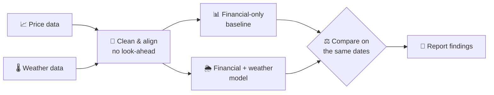

<div align="center">

# 🌦️ Weather-Driven Stock Prediction

**Can the weather tell us something the market doesn't already know?**

A learning project exploring whether weather data can help predict
US stock returns over **5** and **10** trading days.


[Overview](#-overview) •
[First Look](#-first-look-at-the-data) •
[Research Question](#-research-question) •
[Approach](#-approach) •
[Findings](#-findings) •
[Roadmap](#-roadmap) •
[Folder Structure](#-folder-structure) •
[Getting Started](#-getting-started) •
[Disclaimer](#-disclaimer)

</div>

---

## 📌 Overview

> [!NOTE]
> **The project is complete.** See [Findings](#-findings) for the short version.
> **Stages 1 to 5:** Financial-only and financial + weather Ridge
> models were compared under a [plan written before any result](docs/weather-comparison.md),
> on validation 2022 and then once on the locked test years 2023–2024.
> **Finding: no stable weather effect.** Weather never beat the zero
> baseline beyond chance, gains flipped sign between years, and a placebo
> passed the same rule. Details in the [experiment log](reports/results.md)
> (EXP-001, EXP-002). Stage 6 (Google WeatherNext) was
> [skipped](docs/learning-path.md#6-google-weathernext) because its forecast
> archive only starts in 2022. Stage 7 added a local LLM analyst and a
> Streamlit app on top of the saved results (EXP-003).

Energy demand rises on hot and cold days, and utilities feel it first. This
project asks whether that link is strong enough to show up in stock returns,
or whether the market has already priced it in. The goal is to **learn the
full workflow honestly**, from raw data to evaluation, not to build a trading system.

## 🔍 First Look at the Data

All charts use the **training period only (2017–2021)**, so they cannot
influence choices that are later judged on the validation or test years.

### Winter Storm Uri: weather moved the stocks, but not on the same day


- In February 2021 Texas fell more than 20 °C below normal.
- **NRG** slid during the cold days. **VST** *rose* during the storm, then
  lost 24 % in a single day a week after it ended, when the cost became known.
- The weather was public on the day it happened, yet one stock reacted days
  later. This is one event, not proof, but it is why the project looks at
  **5 and 10 day** returns rather than the next day only.
- Extreme cold hurt both companies. A simple "colder means higher power prices
  means higher profits" story would have got the sign wrong, so the effect may
  be **non-linear**.

### Seasons: each region has its own weather risk


Texas demand peaks with summer cooling (CDD), the New York + Chicago gas region
with winter heating (HDD). This is why each asset is paired with its own
region. Markets already know these seasons, so the signal, if any, should be in
the deviation from normal.

### A trap in the anomalies


The largest Texas "heat" anomaly of 2017 was a warm **November** day, not the
summer peak, because the November normal is close to zero. The grid is
stressed by the summer level, not by the November surprise, so stage 5 will
test degree-day **levels** as well as anomalies.

Charts are rebuilt with `scripts/make_figures.py`.

## 🔬 Research Question

<table>
<tr>
<td>

**Does weather data improve predictions compared with financial data alone?**

</td>
</tr>
</table>

| Aspect          | Initial scope                                              |
| --------------- | ---------------------------------------------------------- |
| **Assets**      | NRG, VST (Texas power), UNG (natural gas), SO (control), SPY (benchmark) |
| **Target**      | Forward returns over 5 and 10 trading days                 |
| **Periods**     | Train 2017–2021 · validation 2022 · test 2023–2024 (locked) |
| **Baseline**    | Financial-only model                                       |
| **Challenger**  | Financial + weather model                                  |
| **Stretch**     | Google WeatherNext forecasts (reviewed, skipped: archive starts 2022) |
| **Showcase**    | LLM analyst agent + Streamlit app, after the research is done |

Why these assets and regions were chosen is explained in [data sources](docs/data-sources.md#selection-rationale).

## 🧭 Approach



**Guiding principles**

- ⏱️ **No look-ahead.** Every record uses only information available at the decision time.
- 📅 **Chronological splits.** Train, validation, and test periods follow time order.
- 🪜 **Baseline first.** Establish a naive baseline before training machine learning models.
- ✅ **Null results count.** "Weather doesn't help" is a valid finding and will be reported.

## 🧾 Findings

**Short answer: no.** In this setup, daily weather did not make 5 or 10 day
return forecasts for US energy stocks better than financial data alone, or
better than simply predicting zero.

| What was tested | Result |
| --- | --- |
| Naive baselines (EXP-000) | Predicting a zero return is the bar; nothing simple beats it on 2022 |
| Ridge, financial vs. financial + weather, validation 2022 (EXP-001) | Weather never helps beyond chance; only the SO placebo passes the rule |
| Same, locked test 2023–2024, opened once (EXP-002) | No stable weather effect: signs flip from validation, the placebo passes too, weather never beats zero beyond chance |
| Google WeatherNext forecasts (stage 6) | Skipped: the forecast archive starts in 2022, with no clean period left to train and test on |
| Local LLM analyst, qwen3:8b (EXP-003) | 10/20 test questions right in all runs. Every answer that used a tool was right (18/18); answers without a tool were empty or guessed |

**What was learned**

- **Honest evaluation is most of the work.** Alignment without look-ahead,
  purging at period edges, a plan written before results, a test period
  opened once and a placebo asset did more to shape the conclusion than the
  model choice.
- **A placebo is cheap and decisive.** SO, a utility outside the weather
  story, passed the same decision rule as the "weather" stocks, which is what
  showed that the rule could not tell signal from noise at this sample size.
- **A positive score is not a signal.** Ridge models that beat zero on test
  were mostly betting on the drift of a bull market, not timing anything.
- **Small local agents fail by not using their tools.** Tools that only read
  checked data made every tool-based answer right; the failures came from
  skipped or lost tool calls, and a phrase-based grader catches some of them
  but not all.

**Limitations**

- Five assets, two regions, one model family (Ridge), daily data from
  2017–2024; weather may act through channels not captured here (power
  prices, gas storage, forecasts rather than observations).
- One train / validation / test split; the test years were a strong bull market.
- The agent was evaluated with one small model, thinking off, and a grader
  that checks wording rather than meaning.

**Possible next steps** (each would be a new, separately logged experiment)

- Test the same setups on 2025 data, which no choice in this project has seen.
- Use weather *forecasts* (for example WeatherNext) with their publication
  times, trained and tested inside the archive period.
- Find the cause of the agent's empty replies, then rerun EXP-003 with
  thinking on or a larger model.

## 📅 Roadmap

| #  | Stage                         | Goal                                                                | Status |
| :-: | ----------------------------- | ------------------------------------------------------------------- | :----: |
| 1  | 🐍 **Data analysis basics**    | Learn Pandas and explore a small price dataset                      | ✅ |
| 2  | 🔎 **Data selection**          | Choose assets, regions, and financial & weather sources             | ✅ |
| 3  | 🧹 **Data preparation**        | Clean and align data with no look-ahead                             | ✅ |
| 4  | 📐 **Time series & baselines** | Learn time-series evaluation and build a financial-only baseline   | ✅ |
| 5  | 🌦️ **Weather comparison**      | Compare financial-only vs. financial + weather predictions          | ✅ |
| 6  | 🛰️ **Google WeatherNext**      | Explore WeatherNext forecasts as a final, separate experiment       | ⏭️ |
| 7  | 🤖 **Analyst agent & app**     | LLM agent that answers questions about the results, in a Streamlit app | ✅ |
| 8  | 📢 **Share the findings**      | Document results, including findings that show no improvement      | ✅ |

<sub>⏳ Next · 🚧 In progress · ✅ Done · ⏭️ Skipped · 🔲 Not started</sub>

👉 The detailed checklist for each stage lives in the **[learning roadmap](docs/learning-path.md)**.

<details>
<summary><b>🛰️ About the Google WeatherNext stage</b></summary>
<br/>

Access, terms, costs and the forecast archive were reviewed in November 2026.
The archive starts in 2022 (WeatherNext 2) or 2024 (WeatherNext 3), which does
not overlap the 2017–2021 training period, and 2022–2024 were already used for
validation and testing. The stage was therefore skipped; the review and what a
fair version would need are in the [learning roadmap](docs/learning-path.md#6-google-weathernext).
No integration or access is configured.

</details>

## 📁 Folder Structure

```text
weather-driven-stock-prediction/
├── 📂 app/                # Streamlit app (explorer + agent chat)
├── 📂 data/
│   ├── 📂 raw/              # Original, untouched datasets
│   ├── 📂 processed/        # Cleaned and aligned datasets
│   └── 📂 app/              # Read-only results database (generated)
├── 📂 docs/
│   ├── 📄 learning-path.md  # Stage-by-stage learning roadmap
│   ├── 📄 analyst-agent.md  # Stage 7 plan: agent, tools, evaluation
│   ├── 📄 data-sources.md   # Where every dataset comes from
│   └── 📄 data-preparation.md # How raw data is cleaned and aligned
├── 📂 exploration/          # Exploratory analysis scripts
├── 📂 reports/
│   ├── 📂 figures/          # Generated charts
│   └── 📄 results.md        # Experiment log, including failed attempts
├── 📂 scripts/              # Utility scripts
├── 📂 src/weather_stocks/   # Project source code (installable package)
├── 📂 tests/                # Tests
├── 📄 .gitignore
├── 📄 pyproject.toml
├── 📄 requirements.txt
└── 📄 README.md
```

| Folder              | Purpose                                         | Tracked by Git        |
| ------------------- | ----------------------------------------------- | --------------------- |
| `data/raw/`         | Original downloads, never edited by hand        | ❌ Local only          |
| `data/processed/`   | Data ready for analysis and modeling            | ❌ Local only          |
| `data/app/`         | Results database for the app and the agent      | ❌ Local only          |
| `app/`              | Streamlit app                                    | ✅                     |
| `docs/`             | Roadmap, data sources, and project notes        | ✅                     |
| `exploration/`      | Exploration and learning exercises (`.py`)      | ✅                     |
| `reports/`          | Experiment log and result figures               | ✅                     |
| `scripts/`          | One-off helpers (downloads, conversions)        | ✅                     |
| `src/`              | Reusable project code                           | ✅                     |
| `tests/`            | Tests for the code in `src/`                    | ✅                     |

> [!TIP]
> Empty folders contain `.gitkeep` files so Git can track them. Datasets are
> ignored by `.gitignore` to keep the repository light, while results and
> figures in `reports/` are committed so findings stay visible.
> [`docs/data-sources.md`](docs/data-sources.md) explains how to obtain the data.

## 🚀 Getting Started

**1. Create the environment** (Windows, using [uv](https://docs.astral.sh/uv/)):

```powershell
uv venv --python 3.13 .venv
uv pip install --python .venv -r requirements.txt
```

**2. Download the data** (prices 2016–2024 and hourly weather 1987–2024, saved to `data/raw/`):

```powershell
.venv\Scripts\python scripts/download_prices.py
.venv\Scripts\python scripts/download_weather.py
```

**3. Build the cleaned dataset and run the tests** (output in `data/processed/`):

```powershell
.venv\Scripts\python scripts/build_dataset.py
.venv\Scripts\python -m pytest
```

**4. Redraw the README charts** (training period only, saved to `reports/figures/`):

```powershell
.venv\Scripts\python scripts/make_figures.py
```

**5. Build the results database** (checked against the saved results before it is written):

```powershell
.venv\Scripts\python scripts/build_app_db.py
```

**6. Start the app.** The explorer works on its own; the chat needs
[Ollama](https://ollama.com) with `ollama pull qwen3:8b`:

```powershell
.venv\Scripts\streamlit run app/streamlit_app.py
```

Single questions from the terminal: `.venv\Scripts\python scripts/ask_agent.py "..."`.
The agent evaluation (EXP-003) is rerun with `scripts/run_agent_eval.py`.

**📒 Where things are recorded**

- Progress → [learning roadmap](docs/learning-path.md) checklists
- Data origins → [data sources](docs/data-sources.md)
- Cleaning and alignment → [data preparation](docs/data-preparation.md)
- Experiments and results → [experiment log](reports/results.md)

## ⚠️ Disclaimer

> [!WARNING]
> This is an educational project. Nothing in this repository is financial or
> investment advice. Past patterns, including any found here, do not guarantee
> future returns. Do not use these models or results to make trading decisions.

---

<div align="center">
<sub>Built step by step as a learning journey 🌱</sub>
</div>
