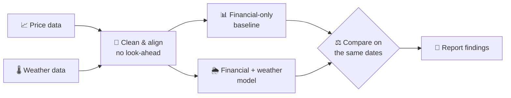

<div align="center">

# 🌦️ Weather-Driven Stock Prediction

**Can the weather tell us something the market doesn't already know?**

A learning project exploring whether weather data can help predict
US stock returns over **5** and **10** trading days.


[Overview](#-overview) •
[Research Question](#-research-question) •
[Approach](#-approach) •
[Roadmap](#-roadmap) •
[Folder Structure](#-folder-structure) •
[Getting Started](#-getting-started) •
[Disclaimer](#-disclaimer)

</div>

---

## 📌 Overview

> [!NOTE]
> **Planning stage only.** This repository currently contains documentation and
> an empty folder skeleton. There is no application code, data collection, model
> training, or test suite yet. Implementation will be added gradually as the
> required concepts are learned.

Energy demand rises on hot and cold days, and utilities feel it first. This
project asks whether that link is strong enough to show up in stock returns,
or whether the market has already priced it in. The goal is to **learn the
full workflow honestly**, from raw data to evaluation, not to build a trading system.

## 🔬 Research Question

<table>
<tr>
<td>

**Does weather data improve predictions compared with financial data alone?**

</td>
</tr>
</table>

| Aspect          | Initial scope                                              |
| --------------- | ---------------------------------------------------------- |
| **Assets**      | A small selection of US energy or utility stocks           |
| **Target**      | Forward returns over 5 and 10 trading days                 |
| **Baseline**    | Financial-only model                                       |
| **Challenger**  | Financial + weather model                                  |
| **Stretch**     | Google WeatherNext forecasts as a separate experiment      |

Assets, regions, and data sources will be chosen during the learning process.

## 🧭 Approach



**Guiding principles**

- ⏱️ **No look-ahead.** Every record uses only information available at the decision time.
- 📅 **Chronological splits.** Train, validation, and test periods follow time order.
- 🪜 **Baseline first.** Establish a naive baseline before training machine learning models.
- ✅ **Null results count.** "Weather doesn't help" is a valid finding and will be reported.

## 📅 Roadmap

| #  | Stage                         | Goal                                                                | Status |
| :-: | ----------------------------- | ------------------------------------------------------------------- | :----: |
| 1  | 🐍 **Data analysis basics**    | Learn Pandas and explore a small price dataset                      | ⏳ Next |
| 2  | 🔎 **Data selection**          | Choose assets, regions, and financial & weather sources             | 🔲 |
| 3  | 🧹 **Data preparation**        | Clean and align data with no look-ahead                             | 🔲 |
| 4  | 📐 **Time series & baselines** | Learn time-series evaluation and build a financial-only baseline   | 🔲 |
| 5  | 🌦️ **Weather comparison**      | Compare financial-only vs. financial + weather predictions          | 🔲 |
| 6  | 🛰️ **Google WeatherNext**      | Explore WeatherNext forecasts as a final, separate experiment       | 🔲 |
| 7  | 📢 **Share the findings**      | Document results, including findings that show no improvement      | 🔲 |

<sub>⏳ Next · 🚧 In progress · ✅ Done · 🔲 Not started</sub>

👉 The detailed checklist for each stage lives in the **[learning roadmap](docs/learning-path.md)**.

<details>
<summary><b>🛰️ About the Google WeatherNext stage</b></summary>
<br/>

WeatherNext integration is a future goal. Access options, costs, usage terms,
forecast archives, and coverage will be reviewed at that stage. No integration
or access is currently configured.

</details>

## 📁 Folder Structure

```text
weather-driven-stock-prediction/
├── 📂 data/
│   ├── 📂 raw/              # Original, untouched datasets
│   └── 📂 processed/        # Cleaned and aligned datasets
├── 📂 docs/
│   ├── 📄 learning-path.md  # Stage-by-stage learning roadmap
│   └── 📄 data-sources.md   # Where every dataset comes from
├── 📂 notebooks/            # Exploratory analysis
├── 📂 reports/
│   ├── 📂 figures/          # Generated charts
│   └── 📄 results.md        # Experiment log, including failed attempts
├── 📂 scripts/              # Utility scripts
├── 📂 src/                  # Project source code
├── 📂 tests/                # Tests
├── 📄 .gitignore
└── 📄 README.md
```

| Folder              | Purpose                                         | Tracked by Git        |
| ------------------- | ----------------------------------------------- | --------------------- |
| `data/raw/`         | Original downloads, never edited by hand        | ❌ Local only          |
| `data/processed/`   | Data ready for analysis and modeling            | ❌ Local only          |
| `docs/`             | Roadmap, data sources, and project notes        | ✅                     |
| `notebooks/`        | Exploration and experiments                     | ✅                     |
| `reports/`          | Experiment log and result figures               | ✅                     |
| `scripts/`          | One-off helpers (downloads, conversions)        | ✅                     |
| `src/`              | Reusable project code                           | ✅                     |
| `tests/`            | Tests for the code in `src/`                    | ✅                     |

> [!TIP]
> Empty folders contain `.gitkeep` files so Git can track them. Datasets are
> ignored by `.gitignore` to keep the repository light, while results and
> figures in `reports/` are committed so findings stay visible.
> [`docs/data-sources.md`](docs/data-sources.md) explains how to obtain the data.

## 🚀 Getting Started

There is nothing to install or run yet. 🙂

**🎯 First task:** learn to read a small CSV, inspect its first five rows,
and explain what each column means.

**📒 Where things are recorded**

- Progress → [learning roadmap](docs/learning-path.md) checklists
- Data origins → [data sources](docs/data-sources.md)
- Experiments and results → [experiment log](reports/results.md)

## ⚠️ Disclaimer

> [!WARNING]
> This is an educational project. Nothing in this repository is financial or
> investment advice. Past patterns, including any found here, do not guarantee
> future returns. Do not use these models or results to make trading decisions.

---

<div align="center">
<sub>Built step by step as a learning journey 🌱</sub>
</div>
