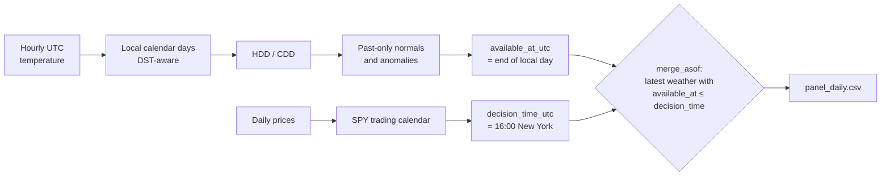

# Data preparation

How the raw downloads become the cleaned, aligned dataset (roadmap stage 3).
The code lives in [`src/weather_stocks/`](../src/weather_stocks) and is run by
[`scripts/build_dataset.py`](../scripts/build_dataset.py).

```powershell
.venv\Scripts\python scripts/build_dataset.py
.venv\Scripts\python -m pytest
```

## The one question this stage answers

> At the market close of trading day *t*, what information did we actually have?

Every step below exists to make sure the dataset never contains anything that
was unknown at that moment.

## Pipeline



1. **Local days** (`weather.to_local_daily`). Hourly UTC values are converted
   to each city's time zone and grouped by local date. Days with missing hours
   are dropped, so daylight saving days (23 or 25 hours) are kept only when
   complete.
2. **Degree days** (`weather.add_degree_days`). `tmean = (tmin + tmax) / 2`,
   `HDD = max(0, 18.3 − tmean)`, `CDD = max(0, tmean − 18.3)` (base 65 °F).
3. **Normals and anomalies** (`weather.past_normals`). The normal for a date in
   year *Y* is the average over years *Y*−30 to *Y*−1 of the values within ±7 days
   of the same day of year. Year *Y* and later years are never used. At least
   25 years of history are required. `anomaly = value − normal`.
4. **Rolling sums.** `hdd_anom_7d` and `cdd_anom_7d` sum the anomalies of the
   last 7 calendar days up to and including the weather day.
5. **Availability.** Each weather day gets `available_at_utc`, the moment that
   local day ends.
6. **Prices** (`prices.build_price_table`). Adjusted closes on the SPY trading
   calendar. Missing prices stay missing and are never filled.
7. **Alignment** (`align.align_to_trading_days`). Each trading day gets the
   latest weather day whose `available_at_utc` is at or before the 16:00
   New York close. If that day is more than 1 day old because of a data gap,
   the weather values are set to missing instead of reusing stale data.
8. **Regions.** `tx` = mean of Houston and Dallas, `gas` = mean of New York and
   Chicago. If one city is missing, the regional value is missing.

## Outputs (`data/processed/`, not tracked by Git)

### `weather_daily.csv`: one row per city and local day

| Column | Meaning |
| ------ | ------- |
| `city`, `date` | City and local calendar date |
| `tmin`, `tmax`, `tmean` | Daily min, max and mean temperature (°C) |
| `hours` | Hours in the local day (23, 24 or 25) |
| `available_at_utc` | When the day's weather is fully known |
| `hdd`, `cdd` | Heating and cooling degree days (°C·day) |
| `*_normal`, `*_anom` | Past-only normal and deviation from it (missing before 2012) |
| `hdd_anom_7d`, `cdd_anom_7d` | 7-day sums of the anomalies |

### `panel_daily.csv`: one row per trading day (2016-01-04 to 2024-12-31)

| Column | Meaning |
| ------ | ------- |
| `date` | Trading date |
| `decision_time_utc` | 16:00 New York close in UTC |
| `adj_close_<ticker>` | Adjusted close for NRG, VST, UNG, SO, SPY |
| `<region>_weather_date` | Local date of the weather used (always the previous calendar day) |
| `<region>_<feature>` | Regional weather features, as listed above, for `tx` and `gas` |

Returns and prediction targets are **not** in this file. They belong to
stage 4, where their windows look into the future by design and must be
handled at the split boundaries.

## Checks

Automated tests in [`tests/`](../tests) cover daylight saving days, partial and
gappy days, degree day formulas, normals never using the current or later
years, the New York close in UTC, and alignment never using same-day or future
weather.

Results of the build on 2026-11-09:

- Prices: no missing days on the calendar, no extra days, no non-positive
  prices. VST is missing its 191 trading days before its October 2016 listing.
- Weather lag: exactly 1 calendar day for all 2,264 trading days in all four cities.
- Coldest known Texas weather vs normal: trading days 2021-02-16 and 2021-02-17
  (Winter Storm Uri).
- Hottest known Texas weather vs normal falls in **shoulder seasons**
  (November, April, October), not summer, because the normal CDD is close to
  zero then. Grid stress comes from summer heat, so stage 5 should test
  degree-day **levels** as well as anomalies.

## Assumptions and limitations

- **ERA5 delay.** ERA5 is published about 5 days late. The dataset treats a
  day's weather as known when the day ends, as if from real-time observations.
  This is fine for asking whether weather *relates* to returns, but a real
  strategy would need live observations or forecasts (stage 6).
- **Early-close days.** The decision time is always 16:00, but the market
  closes at 13:00 on a few days a year. Weather is known by about 01:00 New
  York time, so this does not affect which weather day is used.
- **Equal-weight regions.** Cities are averaged equally rather than by
  population or energy demand.
- **Temperature only.** Wind, humidity and solar radiation are not used yet.
